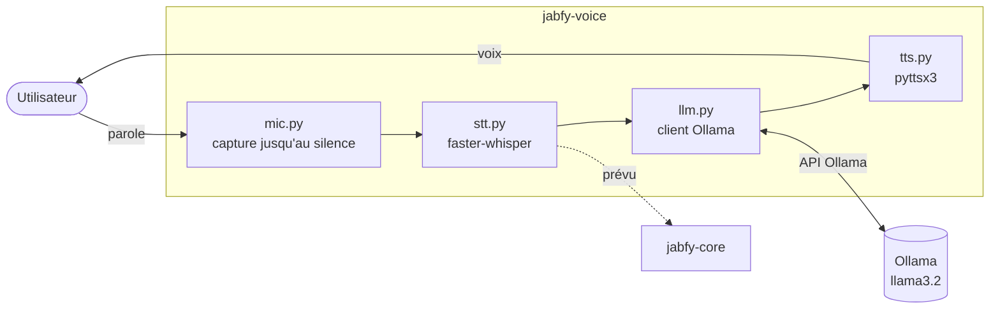

# jabfy-voice

L'assistant vocal de Jabfy, en prototype : il écoute le micro, transcrit la parole en texte, demande une réponse à un modèle de langage local, puis lit la réponse à voix haute. Tout tourne en local, sans service en ligne une fois les modèles téléchargés.

## Rôle dans l'architecture

| Composant | Relation avec jabfy-voice |
|---|---|
| Ollama | Fournit les réponses : jabfy-voice l'appelle directement, avec le modèle `llama3.2`. |
| jabfy-core | Cible prévue : la transcription devra être envoyée à Core, qui propose les actions. Ce n'est pas encore branché. |
| jabfy-tts | Synthèse vocale Kokoro, en Rust. jabfy-voice utilise encore `pyttsx3` ; le choix entre les deux est traité dans la veille TTS. |

Aujourd'hui, jabfy-voice est une **boucle de conversation autonome** : elle répond aux questions, mais ne pilote aucun appareil.

## Pages

| Page | Contenu |
|---|---|
| [Installation et lancement](installation.md) | Prérequis, installation, lancement en terminal ou avec l'interface web, réglages |
| [Fonctionnement interne](fonctionnement.md) | Les quatre étapes de la boucle, les modèles utilisés, les choix d'implémentation |
| [Interfaces](interfaces.md) | Fonctions des modules, API HTTP de l'interface web, dépendances externes |
| [Tests](tests.md) | Vérifications possibles aujourd'hui et tests à écrire |

## État actuel

Au 27/10/2026, sur `main` :

- boucle complète micro → transcription → réponse → voix, en terminal (`main.py`) ou avec une interface web de suivi (`server.py`) ;
- transcription en français par faster-whisper (modèle `base`, CPU, int8) ;
- réponses par Ollama (`llama3.2`), avec l'historique de la conversation ;
- synthèse vocale par `pyttsx3`, qui utilise le moteur du système (eSpeak sous Linux).

Une image conteneur est en préparation sur la branche `voice-3-publish-container-image`, non fusionnée.

## Limites connues et TODO

- [ ] **Pas de mot d'activation** : l'assistant enregistre dès qu'un son dépasse le seuil. Voir la veille Wake word.
- [ ] **Pas encore relié à jabfy-core** : les questions vont directement à Ollama, aucune action domotique n'est proposée.
- [ ] **L'interface web écoute sur toutes les interfaces réseau** (`0.0.0.0:5000`), sans authentification : toute la conversation est lisible depuis le réseau local via `/state`. À limiter à `127.0.0.1`.
- [ ] **Python 3.12 au maximum** : `mic.py` utilise le module `audioop`, retiré de Python 3.13.
- [ ] L'historique de conversation grandit sans limite pendant toute la session.
- [ ] Aucun test automatisé.
- [ ] Les réglages (modèle, langue, seuil de silence) sont des constantes dans le code, pas une configuration.
