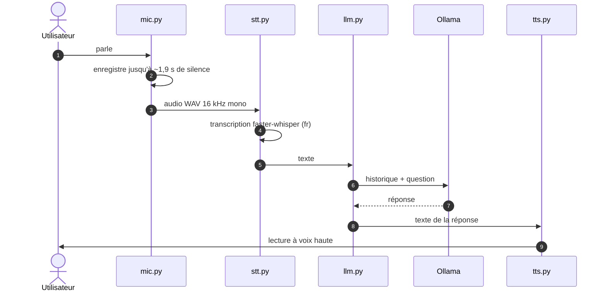

# Fonctionnement interne

## La boucle

`main.py` enchaîne ces étapes dans une boucle infinie. `server.py` fait tourner la même boucle dans un thread, et publie en plus l'état et les messages pour l'interface web.

## Les modules

| Module | Rôle | Détail |
|---|---|---|
| `mic.py` | Capture | Lit le micro par blocs de 1 024 échantillons (16 kHz, mono, 16 bits). L'enregistrement commence quand le volume (RMS) dépasse `SILENCE_THRESHOLD`, et s'arrête après 30 blocs silencieux. Renvoie un fichier WAV en mémoire. |
| `stt.py` | Transcription | faster-whisper, modèle `base`, sur CPU en `int8`, langue forcée en français. Le modèle est chargé une seule fois, au premier appel. |
| `llm.py` | Réponse | Client Ollama, modèle `llama3.2`. Garde tout l'historique de la conversation en mémoire pour que le modèle ait le contexte. |
| `tts.py` | Synthèse | `pyttsx3`, qui pilote le moteur vocal du système (eSpeak sous Linux, SAPI5 sous Windows), à 160 mots par minute. |
| `main.py` | Point d'entrée terminal | La boucle, sans interface. |
| `server.py` | Point d'entrée web | Serveur Flask : la boucle tourne dans un thread, l'état est partagé sous verrou. |
| `templates/index.html` | Interface web | Interroge `/state` régulièrement et affiche la conversation. |

## Choix d'implémentation

- **Tout en local.** Aucun appel à un service en ligne : la transcription, le modèle de langage et la synthèse tournent sur la machine.
- **Détection de fin de phrase par le silence** plutôt que par un mot d'activation : c'est simple à mettre en place, mais l'assistant réagit à tout son assez fort. Le wake word est le prochain chantier.
- **Modèles chargés à la demande** et gardés en mémoire ensuite : le premier tour est plus lent, les suivants non.
- **Une seule conversation par processus**, avec un historique global : suffisant pour un prototype mono-utilisateur.

Les raisons du choix de faster-whisper, d'Ollama et du moteur de synthèse sont détaillées dans les fiches de veille STT, LLM local et TTS de jabfy-docs.
